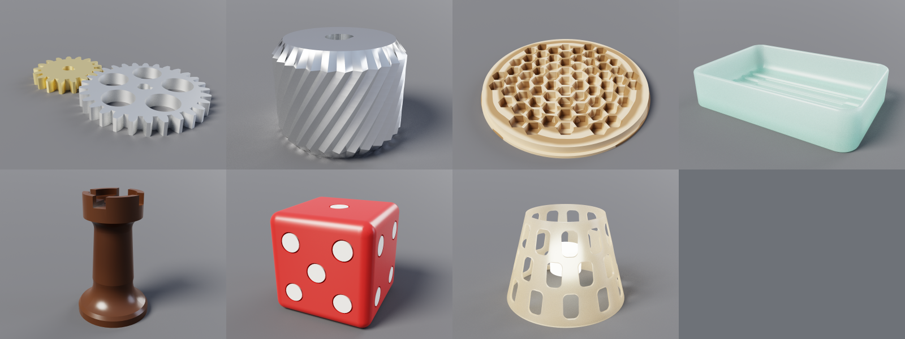

# Cadpole

Cadpole is parametric CAD for bots.

Bring your own coding agent. It builds the model and checks its own work:
it evaluates the model and reads diagnostics that name the line, measures
clearances and volumes, renders pictures and runs the model's tests, all
through one set of typed operations (a CLI and an MCP server). Every
dimension is a parameter: the agent sets it, you drag it in the viewer, and
the model rebuilds the same way every time. You watch in 3D, point at a
face and say what you want
([`docs/assistant-integration.md`](docs/assistant-integration.md)).

It does two kinds of work on one engine: **parts and assemblies**
(mechanical parts, mechanisms, things to print or machine) and **buildings
and plans** (massing, sites, floor plans, sun and shadow). A model is a
Starlark script, which Cadpole evaluates into a feature tree and B-rep
bodies, renders, sweeps, tests, draws as dimensioned sheets and exports.

| | Parts and assemblies | Buildings and plans |
| --- | --- | --- |
| For | brackets, enclosures, gears, threads, mechanisms, whole assemblies | massing, lots and terrain, floor plans, shadow studies, drawing sets |
| Written in | millimetres | feet and inches: `units(units.ft_in)` |
| Adds to the core | assemblies and exploded views, gear and fastener libraries | levels and roofs, lots, setbacks and height envelopes, terrain, sun and shadow, sightlines, plan audits against residential code rules, layout optimisation (`opt`) |
| Start with | [`examples/bracket.star`](examples/bracket.star) | [`examples/cabin_plan.star`](examples/cabin_plan.star) |
| Then | [`gear_toy`](examples/gear_toy.star), [`enclosure`](examples/enclosure.star), [`turbojet`](examples/turbojet.star) | [`hillside_lot`](examples/hillside_lot.star), [`shadow_study`](examples/shadow_study.star), [`room_layout_opt`](examples/room_layout_opt.star), [`house_set`](examples/house_set.star) |
| Guide and reference | [`docs/parts.md`](docs/parts.md) | [`docs/buildings.md`](docs/buildings.md) |

Shared by both: the operations an agent calls, the language, the kernel (sketches, solids, booleans,
fillets), parameters and sweeps, `test()`, renders and animations, drawings
and sheet sets, exports (STL, 3MF, STEP, glTF, SVG, PDF, DXF), print checks,
the web viewer, and the MCP server for coding assistants. The
building side is libraries and a few globals on top; a script for a part
never touches it. The shared language and kernel are documented in
[`docs/starlark-api.md`](docs/starlark-api.md), which both guides point to.

A part:

```python
w = param("width", 40, unit="mm", min=10, max=100)
base = extrude(sketch(XY).rect(w, 20), 10, name="base")
hole = extrude(sketch(XY.offset(-1)).circle(3), 12, name="hole")
part = subtract(base, hole, name="part")
export(part, "part.stl")
```

A building:

```python
units(units.ft_in)
load("@cadpole/building.star", "ft", "floor", "gable_roof")
w = param("width", 24, unit="ft", min=16, max=40)
plate = sketch(XY).rect(ft(w), ft(16))
walls = floor(plate, 0, ft(9), name="walls")
roof = gable_roof(plate, pitch=0.5, overhang=ft(1), eave_z=ft(9), name="roof")
```

The core is Rust, the build is Bazel, and the same engine runs natively and
in the browser (WebAssembly).



## Quick start

Linux (x86_64 or arm64) or macOS (Apple silicon). Two ways to set it up.

**Ask your coding agent.** Paste this into it:

```
Set up Cadpole from github.com/mikelikespie/cadpole: follow its getting-started guide (docs/getting-started.md), build the CLI, and render examples/bracket.star.
```

[`docs/getting-started.md`](docs/getting-started.md) is written to be
followed end to end: exact commands, what each OS needs, and how to check
each step worked.

**Or do it by hand.** Install
[Bazelisk](https://github.com/bazelbuild/bazelisk#installation) as `bazel`,
following its instructions for your platform (`brew install bazelisk` on
macOS, or `npm install -g @bazel/bazelisk` wherever Node is installed): it
fetches the pinned Bazel, and Bazel fetches the Rust toolchain, crates,
clang, Node and everything else. You never run `cargo` or `npm`. macOS also
needs Xcode 27 (Bazel uses its compiler); Linux needs the system C++ headers
(`g++`).

```
./bin/install                                   # once: checks the machine, builds, puts `cadpole` on your PATH
cadpole serve examples/bracket.star             # the web UI
claude mcp add cadpole -- cadpole mcp           # the MCP server, for a coding agent
```

`./bin/install` checks for each of those first and stops with the command
that installs whatever is missing, for your OS and architecture
(`./bin/doctor` prints the same checklist, optional tools included, without
doing anything else). The installed `cadpole` is a link to `bin/cadpole` in
this checkout, which rebuilds the CLI when the checkout has changed, so it
always runs the code you have; `./bin/install --copy` installs a standalone
copy instead, and `./bin/install --uninstall` removes either. Without
installing, run `./bin/cadpole ...` from the checkout, or
`bazel run //:cadpole -- ...` from anywhere in it.

```
cadpole render examples/planter.star -o planter.png
cadpole sweep examples/planter.star --param top_radius=40,55,70 --param wall=1.6,3 -o sheet.png
cadpole animate examples/gear_toy.star -o gear_toy.gif
cadpole export examples/house_set.star --run-exports --out-dir .   # a four-sheet drawing set of a house
cadpole publish examples/cabin_site.star --model-unit ft --out-dir cabin   # a building as a static web page, in feet
```

Every script in `examples/` runs and is tested. `cadpole serve` reloads the
script whenever you save it.

The `claude mcp add` line, run once in the project folder, attaches Claude
Code to a running `cadpole serve` with no URL or port: `cadpole mcp` finds the server through the record it leaves
in your runtime directory and talks to it over a private Unix socket; the TCP
port is the browser's. `--server unix:PATH` or `--server http://HOST:PORT`
(with `cadpole serve --agent-tcp`) picks one explicitly
([`docs/assistant-integration.md`](docs/assistant-integration.md)).

## Documentation

| Document | What it covers |
| --- | --- |
| [`docs/getting-started.md`](docs/getting-started.md) | Building, testing and running on your own machine |
| [`docs/parts.md`](docs/parts.md) | **Parts and assemblies**: what it is for, a first part, the commands, then assemblies, gears, threads and fasteners |
| [`docs/buildings.md`](docs/buildings.md) | **Buildings and plans**: what it is for, a first building, the commands and units, then massing, terrain and lots, sun and shadow, sightlines, layout optimisation and floor plans |
| [`docs/starlark-api.md`](docs/starlark-api.md) | **The shared core** both use: the language, parameters, sketches, solids, booleans, materials, imports; exports, printing, drawings and sheet sets; tests |
| [`docs/design.md`](docs/design.md) | How it works: naming, kernels, rendering, sessions, operations |
| [`docs/architecture.md`](docs/architecture.md) | The software's architecture: crates, the engine and the front ends |
| [`docs/views.md`](docs/views.md), [`docs/drawings.md`](docs/drawings.md) | Rendering, views and drawing sheets |
| [`docs/security.md`](docs/security.md) | The server's threat model, tokens and sandboxing |
| [`docs/assistant-integration.md`](docs/assistant-integration.md) | Driving Cadpole from a coding assistant: MCP tools, waiting for Chat messages at no idle cost, the limited listener |
| [`site/README.md`](site/README.md) | The project site: building, re-rendering and publishing it |
| [`docs/apple-apps.md`](docs/apple-apps.md) | Experimental: native app sources in `src/apple` |

## License

Apache-2.0 (`LICENSE`). Every dependency is Apache-2.0, MIT, BSD or similarly
permissive, and every version is checked against the RustSec and OSV advisory
databases; `bazel test //build_support/...` enforces both.
`THIRD-PARTY-NOTICES.md` is the generated statement of what ships and under
what terms.
