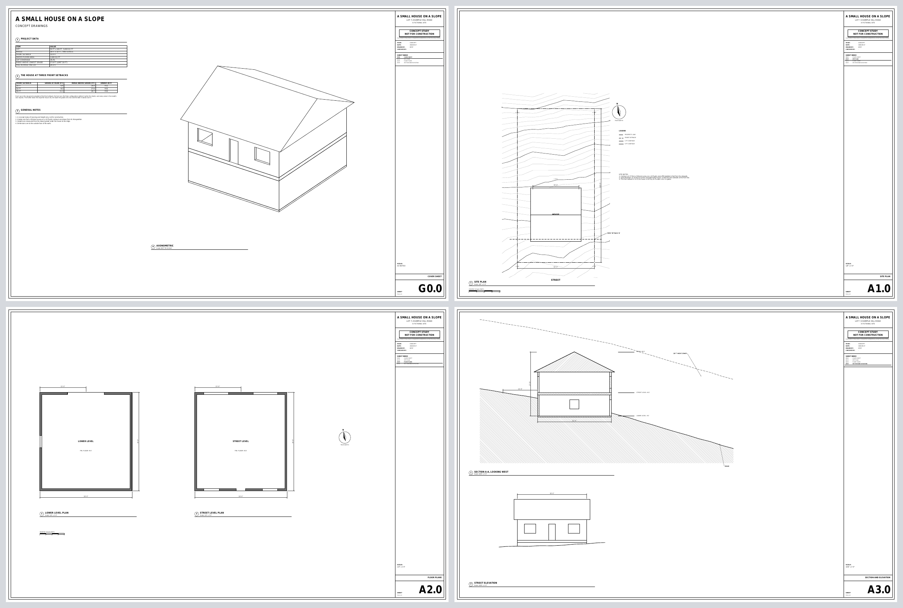

# Drawings and drawing sets

How a model becomes paper: the 2D pipeline, the one-page `drawing()` a part
wants, and the numbered **sheet set** an architect's concept package wants —
ten ARCH D pages with a title column on each, written as one PDF by one
`export()`. The API reference is `docs/starlark-api.md` ("Drawings", "Sheet
sets" and "Formatting numbers"). The worked example is
`examples/house_set.star`:



```
cadpole export examples/house_set.star --run-exports --out-dir /tmp        # /tmp/house_set.pdf, four pages
cadpole op Drawing --doc examples/house_set.star --view sheet:A1.0 --format svg   # one sheet, previewed
cadpole op Drawing --doc examples/house_set.star --view sheets --format pdf       # the whole set
cadpole test examples/house_set.star                                       # the set's own tests
```

## The pipeline

```
bodies ──tessellate──► meshes + edge topology
                             │
   plan / section / elevation / axon view (cadpole_drawing::views)
      clip by half-spaces, project, remove hidden lines, cut faces hatched
                             │
                             ▼
               Group { scale, placement, viewport, items }      model mm
                             │
   sheet: title column, index, annotation, more views           paper mm
                             │
                    Drawing::flatten ──► [Prim]                 paper mm
                             │
            ┌────────────────┼────────────────┐
           svg              pdf              dxf
```

A view is computed once, when the script places it, by the same hidden-line
pass the `Drawing` rpc runs, over **all** the bodies it is given together:
a wall hides the stair behind it, a neighbour hides the house's side. Each
body's lines can go on a layer of its own (`layers={"house": "A-WALL"}`),
and the cut faces of a plan or section are outlined on the section layer
and hatched. The view is then a group: a scale, a placement and a viewport,
nothing more. Flattening applies the transforms, clips every primitive to
its viewport (a path is cut at the edge, a fill is clipped as a polygon,
a string whose anchor falls outside is dropped), expands dimensions into
lines, ticks and text and hatches into strokes, and hands the three writers
one list, so they cannot disagree about where anything is.

**Model units and paper units never mix.** Geometry in a view is model
millimetres; everything that is ink — a line's weight, a dash, a text
height, a hatch's spacing, an arrow — is paper millimetres, so a 0.35 mm
line and 2.5 mm text are the same at 1:1 and at 1:96. A dimension states a
true model length whatever the scale it is drawn at, which is why the
one-page `drawing()` and the `Drawing` rpc figure the overall sizes of an
orthographic view or a section but not of `iso` or `iso-back`: an
axonometric view foreshortens every axis, so no extent of it is a length
of the model. A one-page drawing given an explicit `scale` too large for
its sheet is still drawn at that scale, off the paper, with a note (a
warning in a script, `notes` in the `Drawing` response) that names the
largest standard scale that fits.

**Paint order is call order.** A sheet paints its items in the order the
script made them, whatever layer each is on, so a white fill knocks out
what was drawn before it and nothing after. Inside a view, `under=True`
puts an item beneath the view's own projected lines: contours, then the
roof's outline in white, then the projection, is a site plan whose contours
stop at the house.

## A set

```python
set = sheet_set("house_set", size=sheet.arch_d, units="ft-in", north=-12.0,
                title_block=title_block(project="A SMALL HOUSE ON A SLOPE",
                                        stamp=["CONCEPT STUDY", "NOT FOR CONSTRUCTION"],
                                        issue="CONCEPT", date="2026-09-27", drawn="CADPOLE"))
x0, y0, x1, y1 = set.area()                   # inside the frame, clear of the title column
cover = set.sheet("G0.0", "COVER SHEET")      # no scale: AS NOTED
site = set.sheet("A1.0", "SITE PLAN", scale="1/8\" = 1'-0\"")
...
export(set, "house_set.pdf")
```

The paper is a `sheet` vocabulary member (`sheet.arch_d`, `sheet.arch_c`,
`sheet.a1`, `sheet.a3`, `sheet.letter`, …) or `(w, h)` in millimetres. The
title column runs down the right-hand side, scaled to the paper:
the project block, the boxed stamp and its small print, the issue rows, the
sheet index (generated from the set: every sheet's number and name,
with this one marked), the scale, the sheet's name and its number, large.
The project's lines and the stamp are set smaller rather than run past the
column; the small print, the index and the sheet name wrap.

Lay a sheet out from `set.area()`. Everything a sheet's methods take is
paper millimetres from the sheet's lower-left corner; a table, a note and a
legend hand back the y under them, and `text()` its measured width, so the
next thing goes where the last one ended rather than where a guess put it.
`text_width()` measures without drawing.

## Views

| View | What it is | Its frame |
| --- | --- | --- |
| `plan_view(bodies, cut=z)` | cut at height `z` and seen from above; the cut faces hatched (`hatch="solid"` for poché), what is below projected | the model's x, y |
| `plan_view(bodies, cut=above everything, hatch="none")` | a roof plan: nothing cut, everything below | the model's x, y |
| `section_view(bodies, plane="x=...")` | cut by a plane, the cut faces hatched, what is beyond projected (`depth=` limits how far, `beyond=False` omits it) | along the plane: for `x=` the model's y and z |
| `elevation_view(bodies, direction="south")` | the whole model from one side, hidden lines removed | for south, the model's x and z |
| `axon_view(bodies, az=35, el=28)` | an axonometric, the renderer's azimuth and elevation | the projection's own |
| `image_view(asset("render.png"), at=, width=)` | a picture: a `cadpole render`, a photograph | paper |

Place a view with `at=` — the paper point where the model point `origin=`
lands — or `box=`, a paper rectangle it is centred in (and, on a sheet with
no scale, fitted to at the largest standard ratio). A view clips to the
drawing area unless given `clip=`. `crop=(x0, y0, x1, y1)`, in the view
frame's model millimetres, is the part of the model it shows: the
projection is cut to it and `box=` centres what is left, so a driveway or
a neighbour's house can stop where the drawing's interest does without a
second list of bodies, while what the script draws on the view — a
dimension, a street's name — is clipped by the viewport alone and may stand
outside the crop. Its methods draw in its frame's model
coordinates: `v.dimension((0, 0), (ft(30), 0), offset=-14)` is a 30 ft
dimension along the wall, `v.polyline(profile)` a grade line through the
terrain's own points, `v.sketch(grade.contour_sketch(ft(1)), under=True)`
the contours, `v.point(p)` the paper point a model point landed on.

**Hidden lines** are `hidden="omit"` (removed; the default for every view),
`"dashed"` or `"solid"`. **Hatches** are `lines`, `cross`, `dots`, `solid`,
`earth`, `concrete` and `masonry`, spacing in paper mm.

What is not a body is annotation. A section's grade is the terrain read
along the cut (`[(ft(y), grade.z_at(x, ft(y))) for y in ...]`) drawn as a
heavy polyline with `hatch(region, pattern="earth")` under it; a height
limit is that line raised, dashed; an elevation's ground is a white fill
under the grade line, which hides the walls below it.

## Annotation

Dimensions measure the model and write the set's units: `ft-in` writes
`29'-6 5/16"` to the nearest sixteenth with architectural ticks, metric
units write millimetres with arrows. A set that names no units (or says
`units=None`) takes the document's `units(...)` whole, its fraction
included — `units(units.ft_in, fraction=8)` writes eighths on every sheet —
and a dimension that names none takes the set's. On a sheet,
`dimension(p1, p2)` takes paper points and states their distance at the
sheet's scale; on a view, model points. Text is Helvetica by default —
`font="courier"` for tables of numbers, `font="inter"` for the bundled
face — with `align`, `valign`,
`rotation`, `bold`, `italic` and a colour. `note()` wraps at spaces to a
width; `table()` wraps a cell that is too wide and grows its row; `legend()`
draws its own swatches; `north_arrow()` turns to the set's `north`;
`scale_bar()` divides round feet or metres at the sheet's scale;
`view_title()` is the numbered ring, the title and `Scale: …`; `label()` a
leader. Lines take a weight in mm, a dash (`dashed`, `hidden`, `center` for
property lines, `phantom`, or a list of lengths) and a colour (`"#rrggbb"`,
`grey`, `white`, …); `fill(region, color="white")` is a knock-out.

`format(value, spec)` is Python's: `format(area, ",.0f")` is `1,920`,
`format(z, "+.1f")` is `+18.2`. Starlark's own `%` takes no precision.

## A table of the model at other parameter values

A sheet can tabulate the model at other parameter values. The document says
what it wants and the host runs it:

```python
report("height", ridge - lowest_grade)          # in the model: a named value of this evaluation
rows = sweep_table([{"front_setback": s} for s in [10.0, 15.0, 25.0]],
                   labels=["10 FT", "15 FT", "25 FT"])
for r in rows:
    h = r["values"].get("height")               # None while the row is pending
```

Under `cadpole export --run-exports` (the `Export` rpc with
`run_script_exports`) and the `Drawing` rpc's sheet preview, the host
evaluates the document once to find the tables, once per configuration
with those parameters over the document's own, and once more with the rows
handed in, all through one kernel memo. Everywhere else (the viewer,
`cadpole test`, and every one of those evaluations but the last) the rows are
pending with no values, so a script reads them with `.get()` or a guard. A
configuration that fails is a row with `ok=False` and its first error.
Configurations re-run the whole script, sheets included, because a script
cannot be half-run; a set whose views are slow pays for them once per row.

## Writing and previewing

`export(set, "x.pdf")` is one PDF, a page per sheet at the paper size;
`.svg` and `.dxf` are one file per sheet, `x_<number>.svg`; `export(sheet,
"a2.pdf")` is one sheet in any of the three. The pages are drawn and
written by the host after evaluation, never by the script and never during
an ordinary evaluation. `cadpole export --run-exports` without `--out` writes
the script's files and nothing else (the `Export` rpc's
`script_exports_only`): the whole document is not exported beside them, so
a set's export meshes and checks no body it does not draw.

The PDF is vector throughout and every stream is deflated. **Its text is
text**: a string in Helvetica or Courier is written in the standard face,
WinAnsi-encoded, with no font embedded — every PDF reader carries the
standard faces, so nothing is substituted — and measured from Adobe's own
metrics, so a label is exactly as wide as the layout assumed. `pdftotext`
finds every sheet name, dimension and note. A string in the bundled face
(Inter, `font="inter"`, and every word of the colour look) is real text
too: shaped, kerned, and shown in a TrueType subset of the glyphs the file
uses, instanced at each weight and embedded once. A
string with a character its face or WinAnsi lacks is written as filled
glyph outlines; `sheet_set(text_outlines=True)` does that for every string,
for a plotter that must match the screen exactly.

The SVG names each layer as a group and writes text as `<text>` in the same
face; the DXF keeps the layers, writes text as `TEXT` and leaves pictures
out.

`cadpole op Drawing --view sheet:A2.0 --format svg` previews one page exactly
as the export draws it (sweep rows included), and `--view sheets --format
pdf` the whole set, through the same rpc an assistant or the web UI calls.

## Scripts that load other scripts

A set usually lives beside its model: `sheets/cover.star` loads
`../model/site.star`, which loads its own `dims.star`. A relative `load()`
is resolved from the loading file's directory, and `cadpole` bundles every
file a `load()` reaches, so that works with no symlinks and no absolute
paths. A loaded model's own `export()` calls are its document's, and are
dropped (with one info line) when a sheet script loads it.

## The colour look: plans and sections as the render shows them

`look="color"` draws a plan or section as a picture of the model rather
than as drafting, in vectors: every surface filled in its colour, the cut
walls in theirs, the room names lying on the floors.

```
cadpole export examples/color_plan.star --view top --section z=1200 \
    --crop=-2000,-3000,9500,8500 --title "THE STUDIO, PLAN" \
    --legend "#c9774f=walls" --label "3600,900,740=table" -o plan.pdf
cadpole export examples/color_plan.star --section x=3000 -o section.pdf     # looking toward -x
cadpole export house.star --model-unit ft --view top --section z=5.5 -o l0.pdf   # a script drawn in feet
```

`--section` is `cadpole render`'s: `z=` cuts away what is above and looks
down, `x=`/`y=` cut away what is beyond and look back at the cut, `-x=`
keeps the other side. Each triangle facing the eye is filled in its body's
material colour (lightened a fifth, so the cut reads nearest), the
triangles painted far to near; the solids' creases and smooth silhouettes
are fine lines in a darker shade, each at its own depth; the cut is filled
in the cut body's colour and outlined on top. Glass (under 60 % opacity) is
edges only. A room name the script made with `extrude(text(...), h)` is
written as one string at its model size -- the PDF's text, Inter embedded --
and hidden where the glyphs would be. `--layer` hides layers as a render
does. The page: the title, `--subtitle`, `--legend` swatches, the scale
(an architect's scale for feet and inches) and a scale bar, a north arrow on
a plan (`--north`, else the document's), `--label x,y,z=text` notes on a
white ground, `--note` along the bottom; tabloid turned to suit, or
`--sheet`; `--crop x0,y0,x1,y1` in the view's frame. `--model-unit ft`
scales a script drawn one unit to the foot to millimetres for the drawing,
as `cadpole bake` does. In a sheet set the same views take
`look="color"`; `examples/color_plan.star` puts a colour plan, the same
plan in drafting lines and a colour section on one sheet.

Known limits: the colours are the materials', not a render's lit and
tone-mapped ones; the order is by each triangle's centroid depth, exact for
a plan's level surfaces and a section's walls, not for two long pieces that
interleave in depth; no shadows.

## Not implemented

A live render placed on a sheet (a PNG from `cadpole render` is placed with
`image_view`); a view's projection skipped in the configuration runs, whose
sheets are never written (they cost a full evaluation each); dimension
chains and running dimensions (a chain is several `dimension()` calls);
text along a curve; a DXF picture; faces other than the standard ones and
the bundled one as text (an asset font is outlines); hatching that follows
a curved boundary exactly (a hatch clips to the region's flattened outline).
