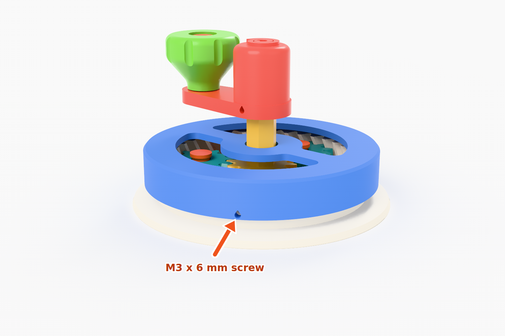

# Illustrations and assembly guides

A render shows a model; an illustration says something about it: this part
goes here, push until it clicks, this gap is 3/4 in. `src/tools/illustrate`
draws arrows, labels, dimensions and markers on a render **at points of the
model**, and builds a step-by-step guide out of such pictures: one picture
per step, a page for a phone, and a PDF for paper.

```
node src/tools/illustrate/main.mjs examples/gear_toy.guide.json --out-dir /tmp/guide \
    --cadpole bazel-opt-bin/src/rust/cadpole-cli/cadpole --chrome /usr/bin/chromium
bazel test //src/tools/illustrate:all
```



## How an annotation finds its place

`cadpole render --camera-json` writes the camera that drew a picture: its
view and projection matrices and the picture's size (`docs/views.md`, "The
camera sidecar"). An annotation gives model points in millimetres, and the
tool projects them through those matrices. So an arrow from `[0, 0, 60]` to
`[0, 0, 30]` lands where those two points are drawn, and when the camera
moves, the picture is re-rendered at another size, or the model is rebuilt at
another parameter value, it still does. Nothing is positioned by eye in
pixels except a caption.

A point that falls outside the picture, or behind the camera, is a warning
naming the annotation; the picture is still made.

## A guide

A guide is a JSON file beside the model. `examples/gear_toy.guide.json` is
the worked example.

```json
{
  "title": "Crank gear toy: putting it together",
  "model": "gear_toy.star",
  "units": "in",
  "steps": [
    {
      "name": "lid_on",
      "title": "Screw the lid on",
      "text": "Lower the lid over the post and turn it clockwise until it stops.",
      "params": {"explode": "28"},
      "layers": {"lid": 0.4},
      "camera": {"target": [0, 0, 48], "direction": [0.5, -0.87, 0.5], "distance": 560, "fov": 24},
      "annotations": [
        {"type": "arrow", "from": [-78, -45, 62], "to": [-78, -45, 26], "text": "down, then clockwise"}
      ]
    }
  ]
}
```

| Field | What it is |
| --- | --- |
| `title`, `subtitle`, `intro` | the page's heading and opening paragraphs |
| `model` | the script, relative to the guide |
| `params` | parameter overrides for every picture |
| `render` | `cadpole render` flags for every picture, in place of the default (path traced, 96 samples, denoised, the product rig on a white backdrop with a matte floor) |
| `size` | `[width, height]` of a step's picture in pixels, 1500 x 1000 unless given |
| `overview` | pictures before the parts and steps: the whole thing, an exploded view |
| `parts` | a grid of small pictures, one per part: `label`, and optionally `key` and `count` |
| `steps` | the numbered steps: `title`, `text` and a picture each |
| `sections` | closing sections: a `title` and `text`, a list of paragraphs |
| `steps_title` | the heading over the steps ("Steps" unless given) |

Every picture, whether in `overview`, `parts` or `steps`, is a **shot**:

| Field | What it is |
| --- | --- |
| `name` | its file name: lower-case letters, digits, `-` and `_`; unique in the guide |
| `params` | parameter overrides for this picture, over the guide's: `{"explode": "28"}` |
| `layers` | display layers for this picture: `"on"`, `"off"`, or an opacity from 0 to 1 |
| `camera` | `{"view": "az=30,el=20"}` (any `--view`), or `{"eye": [...], "target": [...]}`, or `{"target": [...], "direction": [...], "distance": mm}`; `fov` and `up` are optional |
| `size` | this picture's own `[width, height]` |
| `render` | this picture's own render flags |
| `annotations` | what is drawn on it |

**Highlight and ghost** are layers and parameters, because that is what they
are in the model: `"layers": {"lid": 0.3}` ghosts the lid over the part a
step is about, `"layers": {"wheels": "off"}` takes the wheels away, and
`"params": {"explode": "40"}` lifts the parts the way the script's own
parameter does. A script written to be explained declares a layer per group
it will want to hide and a parameter per motion.

## Annotations

Every point is `[x, y, z]` in model millimetres. Offsets and sizes are in
thousandths of the picture's width, so a layout keeps its proportions at any
size.

| `type` | Fields | Draws |
| --- | --- | --- |
| `arrow` | `from`, `to`, `text`, `color` | a thick arrow with a white edge: the way a part moves. The text sits at its tail |
| `label` | `at`, `text`, and `offset: [dx, dy]` with `anchor` (`start`, `middle`, `end`), or `out: r` | text joined by a leader to a dot on the part. `out` pushes the text straight out from the middle of the picture by `r` instead |
| `dot` | `at`, `text`, `color` | a round marker with a character in it: a glue point, a numbered place |
| `dim` | `from`, `to`, `text`, `offset: [dx, dy]` | a dimension line with end ticks, moved off the part by `offset` |
| `outline` | `points` (three or more), `color` | a translucent patch over an area |
| `note` | `text`, and `xy: [fx, fy]` as fractions of the picture, `color`, `anchor`, `size` | a caption that belongs to no point; bottom left unless placed |

All text carries a white halo, so it reads over a black part and over a
white backdrop, and is kept inside the picture. Colours are `#rrggbb`.

`formatLength(mm, "in")` in `annotate.mjs` writes a length the way a ruler
reads, to the nearest sixteenth (`6 3/4 in`), for a guide whose readers
measure in inches.

## What is written

| Under `--out-dir` | |
| --- | --- |
| `raw/<name>.png`, `.json` | each render and its camera. Kept between runs |
| `img/<name>.svg` | the picture with its annotations, one standalone file |
| `img/<name>.png` | the same flattened, with `--chrome` |
| `index.html` | the guide as a page: readable on a phone, and laid out for letter paper when printed |
| `guide.pdf` | the page printed, with `--chrome` |
| `guide-manifest.json` | the steps with their titles, text and pictures; what was rendered and what was kept; the warnings |

**Rendering is the slow part and is done once.** A shot is rendered again
only when what it asks of the renderer changed: its parameters, layers,
camera, size or flags, or the model's file. Moving a label or rewording a
step redraws the annotations over the render that is already there, in well
under a second. `--compose-only` never renders; `--only NAME` works on one
shot; `--force` renders everything.

**Flattening needs a browser.** The annotations are SVG, and the tool has no
rasteriser of its own. `--chrome` (or `CADPOLE_CHROME`) names a Chromium or
Chrome binary, run headless, which turns each SVG into a PNG and prints the
page to PDF. Without one the guide is the HTML page with SVG pictures, which
every browser shows.

A model whose evaluation takes longer than the CLI's two-minute budget needs
`--cadpole-arg=--eval-budget-secs --cadpole-arg=900`.

## As a library

`annotate.mjs` has no dependencies and no file access:

```js
import { cameraOf, overlay, composeSvg } from "./annotate.mjs";

const camera = cameraOf(JSON.parse(sidecarText));         // from --camera-json
const { svg, warnings } = overlay(camera, [
  { type: "arrow", from: [0, 0, 60], to: [0, 0, 30], text: "push" },
]);
const picture = composeSvg(camera, "part.png", svg);      // one SVG over the render
```

`project(camera, [x, y, z])` is the projection alone, for a page that draws
its own marks. `guide.mjs` has the guide: `validateGuide`, `renderShots`,
`composeShots`, `pageHtml` and `buildGuide`, which is what the command runs.

## Not implemented

* A part list generated from the model's `part()` declarations; `parts` is
  written by hand.
* Occlusion: an arrow is drawn over the picture, never behind a part.
* Callout magnifiers, and curved arrows for a turn.
