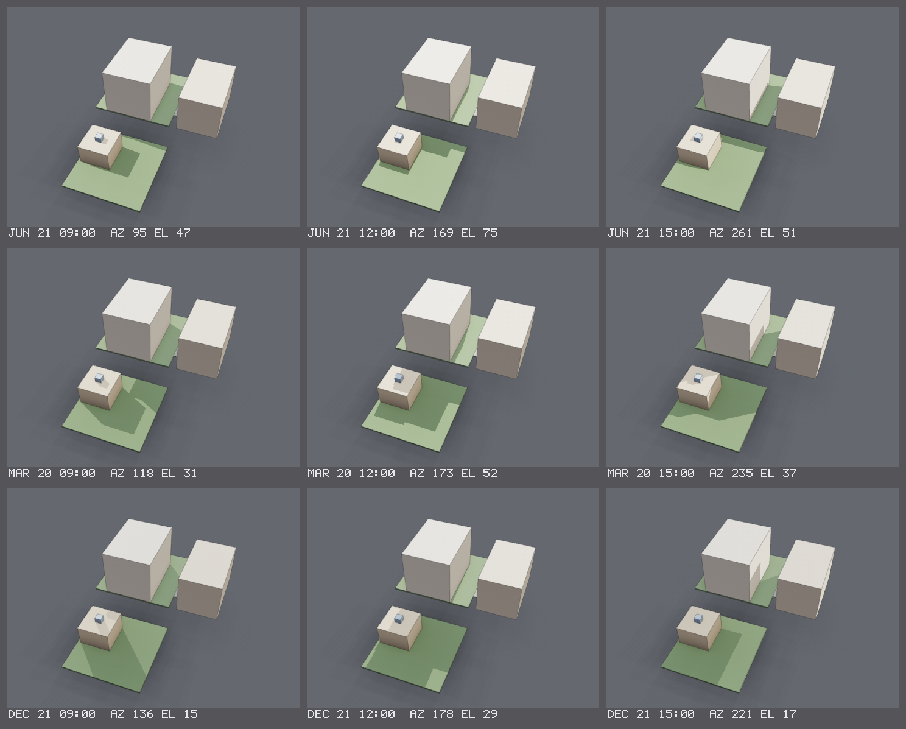
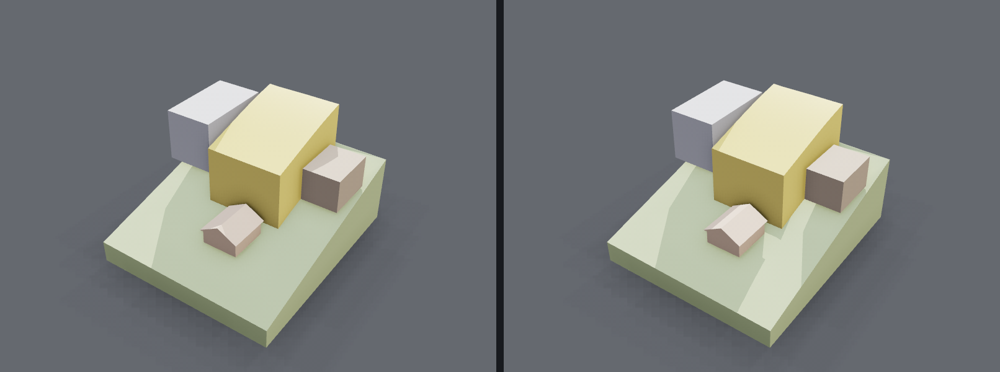

# Views and render options

The options the headless renderer takes: `cadpole render`, `cadpole sweep` and
`cadpole animate` on the command line, and the `Render`, `Sweep` and `Animate`
operations (`RenderRequest`, `SweepRequest`, `AnimateRequest` in
`proto/cadpole/v1/`) behind `cadpole op`, the HTTP API and the MCP tools. The
three commands share one set of view flags; a script sets its own defaults
with `render_defaults()` and moves the camera in an animation with `view()`.

```
cadpole render planter.star --view iso --section z=40 --analysis thickness -o planter.png
```

`cadpole render --help` lists every flag. `cadpole op Render --help` lists the
request's fields as flags; a field with no flag of its own is set with
`--json`.

## Camera and projection

| Flag | Request field | Values |
| --- | --- | --- |
| `--view` | `camera.preset` | `iso` (default), `front`, `back`, `top`, `bottom`, `left`, `right`, `iso-bottom`, `iso-back`, `product`, `hero`, or an angle pair `az=35,el=-25` (azimuth from the front toward the right, elevation above the horizon). A preset fits the model with a margin. |
| `--eye x,y,z`, `--target x,y,z`, `--up x,y,z` | `camera.eye`, `camera.target`, `camera.up` | A free camera: the eye stands exactly there, in model units, and nothing is fitted. `--target` defaults to the model's centre, `--up` to `0,0,1`. Cannot be combined with `--view`. |
| `--fov <deg>` | `camera.fov_degrees` | Vertical field of view. Default: the preset's, 35°, or 24° for `product` and 18° for `hero`. |
| | `camera.orthographic` | An orthographic projection instead of perspective. |
| | `camera.fit_margin` | Padding around the fitted box, as a fraction, instead of the preset's. |
| `--size WxH` | `width`, `height` | Image size in pixels. For `sweep` it is the size of one tile (`--tile` is the same thing). |
| `--shift <fraction>` | `camera.shift` | A shift (perspective-control) lens: the frame slides up the image plane by this fraction of its height (negative: down) and the camera does not turn, so a level camera can take in a tall façade without tilting. Default 0. |
| `--level` | `camera.level` | Turn the view horizontal and shift the lens so the target stays at the centre of the frame: vertical edges come out vertical instead of converging, as an architectural photographer's do. Adds to `--shift`; with `render_defaults(camera=)` it applies to the document's camera. |

When neither `--view` nor `--eye` is given, a render takes the document's
`render_defaults(camera=view(eye=, target=, fov=))` if it declares one, else
`iso`.

Multi-view engineering sheets are vector drawings, not renders:
`drawing(view="three-view")` and the `Drawing` operation draw them, and
`sheet_set()` places plans, sections, elevations and axonometrics on numbered
pages. See `docs/drawings.md` and `docs/starlark-api.md`.

## Edges, grid and x-ray

The rasterizer draws shaded bodies with feature edges over an infinite
ground grid.

| Flag | Request field | Values |
| --- | --- | --- |
| `--edges` | `edge_mode` | `off` (shaded only), `silhouette`, `creases` (default), `all`. `--no-edges` is `off`. |
| `--crease <deg>` | `edge_crease_degrees` | Minimum angle between two surfaces for their shared edge to be drawn (default 30). Tangent seams are never drawn. |
| `--line-width <px>` | `edge_width_px` | Feature-edge width (default 1.15). |
| `--no-silhouettes` | `no_silhouettes` | Leave out silhouette lines. |
| `--grid` | `grid_mode` | `off`, `finite`, `infinite` (default). `--no-grid` is `off`. |
| `--xray` | `xray` | Draw every body translucent (30 % opacity; in the path tracer, a see-through material) so interiors are visible; a debug view still draws opaque. `render`, `sweep` and `animate` take it. |
| `--compare-edges` | | One labelled tile per edge style in a contact sheet. |
| | `highlight_selection` | Draw the session's selection in the highlight colour. |
| | `body_ids` | Draw only these bodies. |

## Layers

A script's `layer(name, visible=, opacity=)` declarations
(`docs/starlark-api.md`, "Layer") are display layers: the web UI's Layers
panel switches each one off and ghosts it with a slider without
re-evaluating, and a render takes the same control as overrides:

```
cadpole render site.star --layer envelope=off --layer terrain=0.4 --layer neighbours=on -o site.png
cadpole sweep  site.star --param house_height=8,10,12 --layer envelope=0.2 -o study.png
cadpole animate site.star -o site.gif --layer terrain=0.5
cadpole op Render --doc site.star --layer envelope=off       # or --layer '{"name":"envelope","visible":false}'
```

`NAME=off` hides a layer, `NAME=on` shows one the script declared hidden,
`NAME=<0..1>` (or `40%`) shows it at that opacity; a layer not named keeps
its own defaults; `other` is the bodies on no layer. A hidden layer's bodies
are left out of the scene (the camera fits what is left); a ghosted layer's
bodies get their material's opacity multiplied by the layer's, so every
backend draws them as it draws `material(opacity=)`: the rasterizer and the
GPU renderer alpha-blend, and the path tracer reads a translucent opacity as
transmission, so **under `--backend path` a ghosted layer is refracting
glass**, not a ghost. Use the rasterizer for a ghosted site shot. In an
animation a keyframe's `view(layers={...})` writes over the request's
overrides from its time on (opacity eased, visibility switched).

## Sections

`cadpole render --section z=40` cuts every body by an axis-aligned plane for
the image only, and caps the cut so a solid reads as solid. `z=40` removes
everything above z = 40 (`x=`, `y=` likewise); `-x=22` removes the −x side
instead. Feature edges are clipped to the kept side and the camera frames
the cut. A body that cannot be cut (not watertight) is drawn whole with a
warning. `cadpole animate --section` applies the cut to every frame.

The cap is a plain surface, not hatched, and the plane is always
axis-aligned. A hatched 2D section is a drawing:
`drawing(view="section:z=40")` slices the model, hatches the cut and
outlines it heavily, and the value accepts any unit (`section:x=12'-6"`).

## Analysis views

`--analysis <field>` colour-maps a measured field over the surface, with a
legend in the image, instead of the bodies' materials.

| Analysis | Meaning |
| --- | --- |
| `thickness` | Wall thickness, measured by a ray down the inward normal plus four on an 18° cone to the opposite surface: red below the minimum, amber at it, green and blue above. `--min-wall <mm>` sets the minimum (default 0.8). |
| `overhang` | Angle from vertical: grey while it is vertical enough to print, red at a flat ceiling. `--max-overhang <deg>` sets the threshold (default 45). Faces resting on the plate read 0, and so do flat faces held up at both ends over a span of at most 10 mm (a window head, a lintel), which a slicer bridges. The bed is the scene's lowest point, so a part held up by another one shows as an overhang. |

## Debug views

`cadpole render --debug <view>` draws the *mesh* rather than the part. Every
view is lit by one flat headlight with no environment, every body is opaque,
and the image is rasterized at one sample whatever `--backend`, `--samples`
or `--xray` say, so a view costs what a draft render costs. `--debug` and
`--analysis` cannot be combined. The overlay flags still apply (`--no-edges`,
`--no-grid`, `--no-silhouettes`, `--crease`). Under `--backend gpu` debug and
analysis views fall back to the CPU rasterizer with a note.

| View | What it shows | The question it answers |
| --- | --- | --- |
| `faces` | Every topology face group in its own colour. The hue steps by the golden ratio from the face index (shifted per body), so the same model colours the same way in every render. Reports `faces: N face groups over T triangles in B bodies` as an info line. | "Did this boolean keep its faces or shatter them?" Kept faces are a handful of clean patches; a shattered body reads as noise. |
| `normals` | The shading normal as RGB, `n * 0.5 + 0.5`, unlit, after the scene's 30° seam-smoothing pass. | "Why does this read faceted?" A smooth surface is a smooth gradient; a facet that should have been smoothed is a step. |
| `defects` | A grey body with the triangles the mesh validator flags painted: crossings **red** (pairs that pass through each other), slivers **orange** (smallest altitude below the tessellation tolerance), folds **magenta** (two triangles sharing an edge within 10° of antiparallel). The counts go to stderr and into the response's diagnostics. | "Is that artefact a bad triangle or real geometry?" |
| `seams` | Flat grey, with every feature edge classified by the crease rule instead of filtered by it: dihedral at or above `--crease` (default 30°) and open boundaries in **black**, the smoothed seams below it in **blue**. | "Where did the 30° rule draw the line?" |
| `wire` | Every triangle edge, one pixel wide, over a faint body. | "Why is this cone band 15,000 triangles?" |

## Environment and quality

| Flag | Values |
| --- | --- |
| `--backend` | `raster` (default), `path`, or `gpu` (the wgpu viewport renderer run headless; falls back to `raster` when the machine has no GPU). See **Choosing a backend**. |
| `--samples N` | Rasterizer: anti-aliasing samples per pixel, 1, 4 or 8 (default 4; a sweep defaults to draft). Path tracer: paths per pixel. |
| `--draft` | Fast preview: 1 sample, no ambient occlusion, no contact shadow. |
| `--no-ao`, `--no-shadow` | Disable screen-space ambient occlusion; disable the ground contact shadow. |
| `--threads N` | Worker threads (default: every hardware thread). Never changes the image. |
| `--exposure X` | Exposure multiplier applied before the tone map (default 1.0). |
| `--background '#rrggbb'` | The flat colour of the pixels the model does not cover, written exactly. `--background transparent` leaves them out and writes coverage as alpha; see **Transparent backgrounds**. |
| `--shadow-catcher` | With a transparent background: keeps the shadow on the ground, as black at the shadow's own alpha. Off by default. |
| `--supersample N` | Renders N times larger each way (1 to 4) and filters down, for finer silhouettes, ink and alpha. |
| `--environment` | Path only: show the studio's environment gradient behind the model instead of the flat background. |
| `--backdrop` | `studio` (a grey cyclorama with a soft top light), `white`, `black`, `#rrggbb`, or `sky` (daylight; see **Daylight**). The environment the path tracer shows and reflects, its floor's colour, and, unless `--background` is given, the rasterizer's background, so the two backends agree. With `--background` as well, the backdrop still lights and reflects in the model, and the pixels it does not cover are the background colour in both backends, edge pixels mixing with it. Unset keeps the rig's own gradient and the dark floor. |
| `--lighting` | `studio` (default; the engineering rig, fixed in world space), `product` (a neutral catalogue rig locked to the camera), or `none` (no rig and a black environment; see **A dark room**). |
| `--floor` | Path only: `matte` (default), `gloss` (a faint reflection of the part), `none`. |
| `--tonemap` | `aces` (default), `neutral` (Khronos PBR Neutral: hue-preserving, exact for base colours), `none` (a plain clamp). |
| `--dof <f-number>`, `--bloom` | Path only. `--dof` is a thin lens sized for the field of view, focused on the model; `--bloom` lets highlights over display white spill a little. Both off by default. |
| `--edge-break [<mm>]` | Path only: shades every crease with a deburred round of that radius (0.25 if the value is left off). |
| `--denoise` | Path only: an edge-aware à-trous filter over the finished image. Off by default. |
| `--bounces N` | Path only: maximum scattering events in one path (default 8). |
| `--sun` | `lat,lon,YYYY-MM-DD,HH:MM[,tz]` computes the sun for a place, a date and a local clock time (`tz` is the clock's offset from UTC in hours; default the longitude's standard zone, no daylight saving). `az=<deg>,el=<deg>` places it by compass azimuth (0 north, 90 east) and elevation. Unset takes the document's `render_defaults(sun=)`, else no sun. See **Shadow studies**. |
| `--north <deg>` | Where north lies in model space, in degrees clockwise from +y seen from above (0: +y is north; 90: +x is north). Unset takes the document's `render_defaults(north=)`, else +y. Turns the sun; nothing else. |
| `--sun-color` | `auto` (default): the sun's colour and strength follow its elevation through the air. `#rrggbb` or a colour temperature such as `3500K` sets the colour instead and keeps the strength. Applies to the document's sun as well. |
| `--sun-intensity X` | Multiplier on the sun's irradiance (default 1). |
| `--haze <dist>[,#rrggbb]` | Path only: aerial perspective. At that distance from the camera half of what is seen is haze (`400m`, `1200ft`; a bare number is mm). Coloured by the environment at the horizon in each direction unless a colour is given. Only camera rays are attenuated, so it dims no shadow and costs nothing. Off by default. |
| `--stats` | Print per-stage render timings to stderr. |

The sun is a directional light with sharp shadows added to whichever rig
`--lighting` names, which is turned down so the sun models the form. The
rasterizer casts one shadow ray per sample through the opaque geometry and
darkens its backdrop where the ground plane is shaded. The path tracer
samples a disc of the sun's own 0.53°, so its shadows have the real penumbra
and its floor is lit by it. A sun below the horizon lights nothing. Guide
geometry (`shadow=False`) is out of both backends' shadows; see **Guide
geometry**.

The sun's colour and strength come from its elevation: its light crosses
more air the lower it stands (Rayleigh and aerosol extinction over the air
mass), so the same `sun(lat, lon, date, hour)` is near white at 60°,
yellow by 20°, orange and much dimmer by 5° and red at the horizon. `--sun-color`
and `--sun-intensity` override it.

## Daylight

`--backdrop sky` lights the scene as the outdoors does. The environment is an
analytic clear sky (the Preetham model, with a low sun's glow, the blue of an
evening sky away from it and the rose band opposite it added) driven by the
sun's direction, the studio rig is switched off, and the sun and that sky
are the only lights: the shadows are filled by the sky, blue in shade and
warm in the sun. With no sun given, the sky brings one at 35° in the
south-south-west. Below the horizon the sun lights nothing, and the sky fades
through twilight over the next few degrees, which is what a dusk shot with
lit windows wants.

The scene is exposed for its light, as a camera's meter would: as the sun
sinks the exposure opens, about 1.6× at 10° and 2.8× at 5°, partly rather
than fully, so golden hour stays warmer and darker than noon. `--exposure`
multiplies it. The path tracer shows and reflects the sky; the rasterizer is
lit by it and paints its horizon colour flat behind the model. The floor is a
mid-dark ground (albedo 0.17).

```
cadpole render street.star -o street.png --backend path --samples 256 --denoise --size 1600x1000 \
    --backdrop sky --sun 34.05,-84.40,2026-12-05,15:36,-8 --haze 300m --level \
    --eye=-1500,25000,1600 --target=9000,10000,2400 --fov 46
```

**Haze** (`--haze`) is aerial perspective: things far off fade into the sky
behind them, warmer toward the sun, which is most of what gives a street or
a landscape its depth. It is applied to the camera's rays only — a shadow
is as dark under the haze as without it, and the light reaching a surface is
not dimmed — so it is free. A few hundred metres suits a street scene;
the default is clear air.

**The shift lens** (`--level`, `--shift`) keeps a building's verticals
vertical: the camera stays level and the frame slides up the image plane
instead of tilting, so an eye at 5 ft can take in a three-storey façade. The
camera sidecar's `projection` includes the shift.

## A dark room

`--lighting none` switches off the rig and its environment: nothing lights
the scene but its own emissive bodies and a sun, if one is given, and the
background is black unless `--background` or `--backdrop` names one
(`--backdrop '#0a0f1e'` is a night sky that lights the scene faintly). A
lamp on a table, a lit room seen from the street at night, a candle in a
lantern: no enclosure has to be built round the scene to keep the studio
out.

Emission is seen through glass at full brightness: a lamp behind a clear
pane, in a glass shade or in a mirror is what the camera sees, and is not
clipped as a caustic. Light leaves a room through its windows to light the
ground outside (a shadow ray crosses a clear pane with its transmission),
and the far face of a thin pane is not stepped over.

## Transparent backgrounds

`--background transparent` on `render`, `animate` and `sweep` writes a PNG
whose alpha is how much of each pixel the model covers, so the image sits on
any page colour with the edge it was rendered with.

```
cadpole render examples/turbojet.star -o turbojet.png --background transparent \
    --backend path --samples 64 --denoise --lighting product --tonemap neutral --no-grid
cadpole render part.star -o part.png --background transparent --shadow-catcher --supersample 2
cadpole animate examples/gear_toy.star -o frames/ --format frames --background transparent
```

- **Alpha is coverage.** Each sample that reaches the model counts, through
  the same filter the colour takes, so an edge pixel half over the model has
  alpha one half. Colour is accumulated premultiplied and divided out on
  writing: the PNG is 8-bit straight alpha, and an edge pixel holds the
  model's own colour, never a mix with a background. Composite it over black,
  white or a saturated colour and there is no fringe.
- **Light still comes from the environment.** The rig, the `--backdrop` and
  the sky light the model and show in its reflections; they are only left out
  of the pixels the model does not cover. The path tracer's floor is left
  out with them.
- **Glass is partly transparent** under the path tracer: a path that leaves
  a clear part without being scattered lets the page through, tinted
  highlights and reflections stay. The rasterizer blends translucent
  materials by their opacity.
- **`--shadow-catcher`** keeps the shadow the model drops on the ground:
  black, at an alpha equal to how much the shadow darkens the floor. Under
  the path tracer that is the lights' real soft shadow; under the rasterizer
  it is the contact shadow (a `--sun` shadow on the ground is not caught).
- **The grid and the ink** (rasterizer) are written with their own alpha:
  the grid fades with distance as it does on a background, and `--no-grid`
  leaves it out.
- **`--denoise`** filters the colour and leaves the alpha as traced, so it
  draws no halo. **`--bloom`** adds its glow to the alpha where it spills
  past the silhouette.
- **`--backend gpu`** (`render` only) renders twice, over black and over
  white, and takes alpha from the difference.
- **Sheets** (`sweep`, `--shadow-study`, `--compare-edges`) are transparent
  between and around their tiles.
- **A GIF cannot do this**: a GIF pixel is opaque or absent, so
  `animate --format gif --background transparent` is refused. Write `apng`
  or `frames`.

**Edges.** A silhouette is as smooth as the number of samples in a pixel
allows. The rasterizer has `--samples` positions per pixel (8 at most), so
eight levels of alpha along an edge; the path tracer has as many as it traces
paths. `--supersample N` renders at N times the width and height and
averages N×N blocks, alpha included: `--samples 8 --supersample 2` is 32
positions per pixel. The path tracer keeps its cost by tracing
`samples / N²` paths per rendered pixel, so there it sharpens textures and
ink more than it changes noise. The larger image counts against the
16-megapixel render limit; a request over it lowers N and says so.

On an opaque background the same rule holds inside the renderer: the model
is tone-mapped first and mixed by coverage with what is behind it
afterwards, so a bright part on a dark background has an edge that ramps
evenly to the background's own colour.

### The camera sidecar

`--camera-json FILE` on `render` and `animate` writes the camera of every
frame, for a page that draws in the picture's own perspective: a ground grid
under a transparent frame, a label pinned to a part.

```
cadpole render part.star -o part.png --background transparent --camera-json part.json
```

```json
{
  "width": 1800, "height": 1200, "units": "mm",
  "frames": [{
    "index": 0, "t": 0.0,
    "eye": [412.1, -713.8, 268.0], "target": [0.0, 0.0, 41.5], "up": [0, 0, 1],
    "fov_degrees": 24.0, "orthographic": false, "ortho_height": 0.0, "shift": 0.0,
    "near": 310.2, "far": 3480.0,
    "view": [16 numbers], "projection": [16 numbers],
    "ground": {"origin": [0, 0, 0], "normal": [0, 0, 1], "u": [1, 0, 0], "v": [0, 1, 0]},
    "bounds": {"min": [-80, -60, 0], "max": [80, 60, 83], "px": [402.5, 311.0, 1396.2, 905.4]}
  }]
}
```

Lengths are model millimetres. `view` and `projection` are row-major 4×4
matrices on column vectors in the OpenGL convention:
`clip = projection · view · (x, y, z, 1)`, `ndc = clip.xyz / clip.w`,
`x_px = (ndc.x + 1) / 2 · width`, `y_px = (1 − ndc.y) / 2 · height`, with
pixel (0, 0) the top-left corner. `ground` is the plane the model stands on
(the lowest point of what is drawn; the path tracer's floor and the
rasterizer's grid lie in it) with two in-plane axes one millimetre long.
`shift` is the lens shift as a fraction of the frame height (see
`--shift`); `projection` already includes it. `bounds.px` is the rectangle
around the eight projected corners of the model's bounding box, `[x0, y0, x1, y1]`: never smaller than what is drawn,
often larger, and it may pass the image's edge. It is empty when part of the
box is behind the camera. `near` and `far` bound the
depth range the projection maps; the renderers clip nothing. An animation
writes one entry per frame, `t` in seconds. The same values are
`RenderResponse.camera` and `AnimateResponse.cameras`.

## Choosing a backend

`cadpole render --backend raster|path` picks which renderer draws the image.
`cadpole sweep` always uses the rasterizer.

| | `raster` (default) | `path` |
| --- | --- | --- |
| Shadows | screen-space contact shadow under the model | real soft shadows from three area lights |
| Occlusion | SSAO, screen-space | true ambient occlusion, as a consequence of the transport |
| Bounce light | none (a flat environment term) | full global illumination, including colour bleeding between parts |
| Translucency | sorted blend, no bending | refraction by Snell's law, Beer-Lambert absorption through the thickness, subsurface scattering |
| Emissive materials | glow, but light nothing | are light sources, seen and shining through glass |
| Sky and haze | lit by `--backdrop sky`, which it paints flat | the daylight sky, shown and reflected; `--haze` |
| Edges, grid | antialiased crease-filtered ink, infinite grid | neither; it has a real floor and real contact instead |
| Transparent background | coverage alpha, one level per sample; the grid and the ink carry their own | coverage alpha from every path; glass is partly transparent |
| Determinism | byte-identical for any thread count | byte-identical for any thread count |

Use `raster` for sweeps, thumbnails, iterating on a shape and anything an
assistant will look at dozens of times. Use `path` for the finished picture,
and for anything where the *material* is the question: whether a translucent
wall is thick enough to hide the infill, how a clear resin print catches the
light, whether a glow filament reads as glowing.

With `--backend path`, `--samples N` is paths per pixel, and noise falls as
`1/sqrt(N)`: 16 is a framing check, 64 is a good preview, 256 is a finished
image. Translucent and scattering materials need roughly twice that.
`--bounces N` caps the scattering events in one path; Russian roulette
usually ends a path well before it, and a scene of clear parts stacked
several deep is the case that wants more.

## The product shot

The recommended still of a finished part:

```
cadpole render part.star -o part.png \
    --backend path --samples 256 --size 1600x1200 \
    --view product --lighting product --backdrop studio --floor gloss --tonemap neutral \
    --edge-break 0.25            # a machined part; leave it off for a print
    # --dof 8 --bloom            # for a hero still
    # --denoise                  # for a still, not for judging a finish
```

| Flag | What it does | Numbers |
| --- | --- | --- |
| `--view product` (`hero`) | A three-quarter view near eye level on a normal lens, with more air around the part and the subject a little below the middle of the frame. | az 30°, el 18°, 24° vertical fov, margin 0.25, subject centre at 45 % of the frame height; `hero` is az 35°, el 12°, 18°, 0.30 |
| `--lighting product` | A neutral three-light rig that turns with the camera, so a `back` view is not lit from behind: key 40° to camera-left at 40° up, a large soft fill 55° to the right, a narrow rim behind. | key 3.2 (22° cone), fill 0.8 (30°), rim 1.6 (8°); sky 0.60 / horizon 0.35 / ground 0.25 |
| `--backdrop studio` | An infinite cyclorama: the environment is visible and reflected, and the floor lands on the horizon tone so the two meet without a line. | floor albedo 0.40 (`white` 0.85, `black` 0.03) |
| `--floor gloss` | The floor reflects the part faintly: 4 % at normal incidence, rising at grazing. | roughness 0.35; `matte` is 0.85 |
| `--tonemap neutral` | Khronos PBR Neutral: exact for base colours under unit light, no hue rotation, a controlled desaturation toward white above 0.76. | |
| `--edge-break 0.25` | Every crease is shaded as if deburred to a round of that radius, so edges catch the light on a thin line. No geometry changes. A material's `edge_break=` overrides it per body. | the creases are the mesh's edges that fold past `--crease` (30°); a fold within 15° of that gets a narrower round, and an edge whose fold fades below it tapers out; `--edge-break 0` builds nothing |
| `--dof 8` | A thin lens: a 24 mm frame height makes the focal length `12 / tan(fov/2)` mm and the aperture radius `f / 2N`. Focus is at the camera target. | |
| `--bloom` | `max(hdr − 1, 0)` blurred at σ = 1 % of the width and added back at 5 %. | the backdrop next to a highlight is no longer bit-exact |
| `--denoise` | An edge-aware à-trous filter guided by the first hit's normal, albedo, depth and each pixel's own sample variance. | costs detail below the noise level: the sheen of sub-pixel grooves, fine highlight structure |

**Machining marks** are a material's, not the view's: `texture="turned"`
(fine concentric grooves about the part's axis), `"milled"` (fine parallel
scallops along a face's ruling) and `"machined"` (turned on the faces a lathe
made, milled on the rest). `examples/compressor_wheel.star` and
`examples/impeller.star` use the last. See `docs/starlark-api.md`,
"Material".

**The preview.** The same flags on `--backend raster --no-grid --no-edges`
give the rasterizer's version: the rig, the backdrop's tone and the tone
curve agree; it has no floor reflection, no depth of field and no edge
break. `--backend gpu` falls back to the CPU rasterizer for
`--lighting product` and any `--backdrop`, with a note.

## Shadow studies

`cadpole render --shadow-study` draws the model under the sun at several
dates and times as one sheet:

```
cadpole render examples/shadow_study.star --shadow-study \
    --sun 38,-121,2026-06-21,12:00,-8 \
    --view az=200,el=45 --size 480x360 --no-grid -o shadow_study.png
```

`--sun` names the place and the year (its date and time are otherwise
unused); the rows are the June solstice, the March equinox and the December
solstice of that year (or `--dates YYYY-MM-DD,...`), the columns the times
of `--times HH:MM,...` (default `09:00,12:00,15:00`). Every tile is one
render with the same `--view` fitted to the same scene, `--size` is a tile,
and each label carries the sun's azimuth and elevation. A study that is a
list rather than a grid is `--at`, one instant per flag, in that order:

```
cadpole render examples/shadow_study.star --shadow-study --sun 38,-121,2026-01-01,00:00,-8 \
    --at 2026-12-21,12:00 --at 2026-03-20,09:00 --at 2026-03-20,15:00 \
    --view az=200,el=45 --size 480x360 --no-grid -o three.png
```

Up to four `--at` tiles make one row; more make a near-square grid.



The numbers behind the pictures are the script's: `shadow_study(house,
on=court_top, sun=sun(...))[0].area()` is the exact footprint on the court
(`docs/buildings.md`), and a `test()` can hold it at zero.

**Other ways to the same sheet.** A document whose `render_defaults(sun=
sun(LAT, LON, date, hour))` reads two parameters is lit by that sun in
every render, so `cadpole sweep examples/shadow_study.star --param hour=9,12,15`
is a row of the study with the sweep's own tiling, and `--param
date=2026-12-21 --param hour=9` one tile. For a day's sun sweep as a film,
declare an animation over the hour; the sun is recomputed every frame from
the parameter:

```python
hour = param("hour", 12.0, unit="h", min=5, max=21)
render_defaults(sun=sun(38.0, -121.0, "2026-12-21", hour, tz=-8))
animation("day", [keyframe(0, hour=7.5), keyframe(6, hour=17)], fps=10, ease=ease.linear)
```

```
cadpole animate examples/shadow_study.star --name day --view az=200,el=45 --no-grid -o day.gif
```

**A picture from a window.** `--eye x,y,z --target x,y,z` puts the camera at
a point in the model, such as a second-floor window or a sidewalk position
5.5 ft up, and the document's `render_defaults(camera=view(eye=, target=))`
makes that the default. `sightline()`, `sightlines()` and `view_cone()`
(`docs/buildings.md`) answer the same question as numbers.

## Guide geometry

A site model carries bodies that are not things: a zoning envelope over the
house, a setback plane, the lot lines, a section marker, the terrain's
contours. They have to be in the picture and they must not be in the light.
A material has a `shadow` flag, true by default, and
`body.material(shadow=False)` or `paint(body, shadow=False)` makes the body
**guide geometry: visible to the camera, invisible to light.**

In the path tracer the camera's own view (the specular chain from the eye,
so also what is seen through a clear guide or in a mirror) meets it, and
nothing else does: no shadow ray stops at it or is tinted by it, no bounce
meets it, it is no light source even when emissive, and it has no interior
(`attenuation=` and `scatter=` do nothing on one). Its own surface is still
lit and shadowed by the real bodies. In the rasterizer it is left out of the
sun shadow and the contact shadow and drawn in the colour pass as any body
is. The web viewer draws no shadows, so the flag changes nothing there.

The flag is the renderer's: `shadow_study()`, `sightline()`, `sightlines()`
and `view_cone()` take explicit body lists, and a body you pass them is a
caster or an obstacle whatever its material says.
`examples/hillside_lot.star`'s envelope is the case:



Left, `shadow=True`: the envelope (drawn opaque here) shadows the ground and
the neighbour behind it. Right, `shadow=False`: guide geometry, and only the
house under it casts a shadow.

## Animations: `cadpole animate`

`cadpole animate part.star -o part.gif` renders an animation the script
declares with `animation(name, keyframes, ...)` (`docs/starlark-api.md`):
the document is evaluated once per frame with the keyframes' interpolated
parameter values as overrides, through one kernel-op memo, and every frame
is drawn with one camera fitted to the union of the scenes at every
keyframe. The same operation is the `animate` MCP tool and `cadpole op
Animate`.

```
cadpole animate examples/gear_toy.star --list                       # what the script declares
cadpole animate examples/gear_toy.star -o gear_toy.gif \
    --view product --lighting product --backdrop studio --tonemap neutral --no-grid --no-edges
cadpole animate examples/gear_toy.star -o gear_toy.apng --size 1600x1200   # lossless, plays in every browser
cadpole animate examples/gear_toy.star -o frames/ --format frames --frames 24   # 24 PNGs over the whole animation
cadpole animate examples/planetary.star -o turn.gif --fps 15 --draft            # a quick look
```

| Flag | What it does |
| --- | --- |
| `--name NAME` | Which animation, when the script declares several. |
| `-o FILE\|DIR`, `--format apng\|gif\|frames` | The file; the format is read off the extension (`.gif`, `.apng`/`.png`, none for a directory of frames) unless given. |
| `--fps N` | The frame rate, over the script's `fps=`. |
| `--frames N` | Exactly N frames over the whole animation instead of one per 1/fps. Never more than 4096: an animation whose `fps` would need more is resampled to 4096 frames over its whole duration, each shown for duration/4095 s (a warning says so), so the file still plays for the animation's length. |
| `--preview` | Evaluate every frame as a drag preview: a fuse a keyframe reaches is skipped and its operands shown. Exact for an animation of poses. |
| `--list` | Print the declarations and render nothing. |
| `--variant NAME=WxH` | Repeatable, instead of `--size`: renders the animation once per variant, each with a camera fitted to its own aspect ratio. Frames go to `DIR/NAME/`, a file to `FILE_NAME.ext`. |
| `--camera-json FILE` | Every frame's camera, ground plane and pixel bounds (see **The camera sidecar**); `FILE_NAME.json` per variant. |
| the view flags | Every flag above, as `cadpole render` takes it, applied to every frame. `--analysis`, `--debug` and `--backend gpu` are `render`-only and refused: the frames are drawn by the raster or path backend with the bodies' own colours. |

It prints the file and its size, the frame count and rate, where the time
went (the first evaluation, which fills the memo; the later evaluations and
the renders per frame; the camera fit; the encode), and the counts after the
first frame: kernel ops, tessellations, bakes and memo hits per frame, which
for an animation of poses read `0 kernel ops, 0 tessellations`. `cadpole op
Animate --doc part.star --name x` returns the same as JSON with the file
base64 in `data` and every frame's `eval_ms`, `render_ms`, `ops_run`,
`ops_hit`, `tessellations` and `bakes` in `frame_stats`.

**The camera.** Fixed unless a keyframe moves it: the `--view` preset fitted
once to the union of the keyframes' scene bounding boxes (with the preset's
margin and subject placement), so an exploded assembly and its assembled
state are framed alike. A keyframe's `camera=view(az=, el=, fov=, zoom=,
pan=)` moves that camera about the same target, easing from the preset's
own angles (`product` is az 30, el 18) the short way round, from zoom 1 and
no pan. A keyframe's
`camera=view(..., layers={"envelope": False, "terrain": 0.4})` switches and
ghosts display layers from its time on (see **Layers**); the request's own
`--layer` flags are the state before the first such keyframe.

**A drift over an explode.** The fit accounts for the camera's whole path:
the distance is chosen so that the union box is inside the frame at every
frame's angle, lens, zoom and pan, and `zoom=` is relative to that. The
frame that needs the most room fits exactly; the others have room to spare.

```python
cut = param("cutaway", False)
lift = param("explode", 0.0, min=0, max=1)

animation("open_up", [
    keyframe(0, cutaway=True, explode=0, camera=view(az=24, el=16)),
    keyframe(4, explode=1, camera=view(az=32, zoom=1.12, pan=(0.03, 0))),
])
```

```
cadpole animate engine.star --name open_up -o frames/ --format frames --frames 48 \
    --variant landscape=1800x1200 --variant portrait=1080x1620 \
    --background transparent --camera-json frames/camera.json
```

That holds the cutaway from the first frame (a parameter the later keyframes
do not name keeps its value), turns the camera 8° and closes in 12 % while
the parts come apart, and writes `frames/landscape/frame_0000.png` … and
`frames/portrait/frame_0000.png` …, each framed for its own shape, with
`frames/camera_landscape.json` and `frames/camera_portrait.json`. A request
`--section` likewise cuts every frame. The same request gives the same
bytes.

**A turntable.** A script that declares nothing but a camera path:

```python
animation("turntable", [
    keyframe(0, camera=view(az=30, el=18), ease=ease.linear),
    keyframe(2, camera=view(az=150), ease=ease.linear),
    keyframe(4, camera=view(az=270), ease=ease.linear),
    keyframe(6, camera=view(az=30)),
], fps=30, loop=True)
```

`cadpole animate part.star -o part.gif --view product --lighting product
--backdrop studio --tonemap neutral --no-grid --no-edges` then orbits the
product shot once in six seconds. Three legs of 120°, because the azimuth
always turns the short way round (a keyframe at `az=390` would be the same
place as 30 and not move); `loop=True` stops one frame short of the last
keyframe, which is where the first already is, so the loop is seamless. The
`product` rig turns with the camera. Every frame is a memo hit (the geometry
never changes), so the cost is the renders.

**Cost.** Raster frames are cheap; the path tracer is a finished-still tool,
so `--backend path` belongs to a short animation at `--samples 64` or more,
with `--denoise`. Under `cadpole serve` an animation runs inside the same
gate as `Render` and `Sweep`, so `--render-budget-ms` (default 60 s) applies
to the whole request; render long animations with the CLI.

**Sizes.** A delta frame writes only the pixels that changed, so a part
turning on a still backdrop costs the pixels it swept. APNG is lossless;
GIF is smaller.
